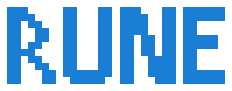

<picture>
  <source media="(prefers-color-scheme: dark)" srcset="assets/rune-wordmark-dark.svg">
  
</picture>

# awesome-rune

A curated list of projects built with or for [Rune](https://github.com/anomalyco/rune), a native GPU-rendered Rust UI framework for macOS, Windows, Linux and the web, with its own renderer, text, layout and springs.

[Repository](https://github.com/anomalyco/rune) · [Docs](https://github.com/anomalyco/rune/blob/dev/crates/rune/README.md) · [Components](https://github.com/anomalyco/rune/blob/dev/crates/rune-kit/README.md) · [Examples](https://github.com/anomalyco/rune/tree/dev/examples)

Rune is pre-release, so most projects here pin a <code>dev</code> revision and move fast.

<!-- This file is generated from README.template.md and projects.json. -->
## Featured

<table>
<tr>
<td align="center" valign="top" width="33%">
 
<a href="https://github.com/anomalyco/hex"><b>Hex</b></a> 
 <b>5.6k</b> 
 
<code>v3.3.0</code> 4d ago 
Local voice dictation for macOS, Windows and Linux.
</td>
<td align="center" valign="top" width="33%">
 
<a href="https://github.com/kitlangton/psychopomp"><b>Psychopomp</b></a> 
 <b>419</b> 
 
Code-first motion graphics: a small Rust program describes a scene, rendered as 1080p60 video with motion blur or played as an interactive presentation.
</td>
<td align="center" valign="top" width="33%">
 
<a href="https://github.com/anomalyco/deadbolt"><b>Deadbolt</b></a> 
 <b>275</b> 
 
A decentralized password manager: devices sync directly over iroh and join by pairing, with no accounts or servers.
</td>
</tr>
</table>

## Apps

[Developer Tools](#developer-tools) · [Productivity](#productivity) · [Media](#media) · [System Utilities](#system-utilities) · [Games](#games) · [Demos & Examples](#demos--examples)

### Developer Tools

<table>
<tr>
<td align="center" valign="top" width="33%">
 
<a href="https://github.com/RyanLatimer/usage-tracker/tree/master/native"><b>agent-usage</b></a> 
 <b>0</b> 
 
Native UI for agent-usage: sessions, tokens and API cost summed across every installed coding harness, per harness and per model.
</td>
<td align="center" valign="top" width="33%">
 
<a href="https://github.com/no-phux/phux/tree/main/clients/rune"><b>phux</b></a> 
 <b>22</b> 
 
<code>v0.125.0</code> today 
Alpha desktop client for phux, a terminal multiplexer whose server you can drive from code and that tracks which panes run a coding agent.
</td>
<td align="center" valign="top" width="33%">
 
<a href="https://github.com/mweinbach/prime-agent-ui"><b>Prime Agent Desktop</b></a> 
 <b>1</b> 
 
<code>desktop-v0.11.0</code> today 
Unofficial desktop client for Prime Agent that shares the CLI&#x27;s daemon, saved chats and provider credentials.
</td>
</tr>
<tr>
<td align="center" valign="top" width="33%">
 
<a href="https://github.com/shuv1337/rex-rune"><b>Rex for Linux</b></a> 
 <b>28</b> 
 
<code>v0.3.2</code> today 
Unofficial native Linux client for Rex, the terminal multiplexer from Superlogical.
</td>
<td align="center" valign="top" width="33%">
 
<a href="https://github.com/ImBIOS/t3code-desktop-rune"><b>t3code-desktop-rune</b></a> 
 <b>1</b> 
 
T3 Code Desktop recreated in Rune for Linux, targeting 1:1 parity with the nightly build.
</td>
</tr>
</table>

### Productivity

<table>
<tr>
<td align="center" valign="top" width="33%">
 
<a href="https://github.com/anomalyco/deadbolt"><b>Deadbolt</b></a> 
 <b>275</b> 
 
A decentralized password manager: devices sync directly over iroh and join by pairing, with no accounts or servers.
</td>
<td align="center" valign="top" width="33%">
 
<a href="https://github.com/anomalyco/grim"><b>Grim</b></a> 
 <b>114</b> 
 
A multiplayer Markdown notebook for people and agents, with notes stored in Git and a native Mac app.
</td>
<td align="center" valign="top" width="33%">
 
<a href="https://github.com/anomalyco/hex"><b>Hex</b></a> 
 <b>5.6k</b> 
 
<code>v3.3.0</code> 4d ago 
Local voice dictation for macOS, Windows and Linux.
</td>
</tr>
<tr>
<td align="center" valign="top" width="33%">
 
<a href="https://github.com/mokmok-dev/koe"><b>koe</b></a> 
 <b>0</b> 
 
A privacy-first recorder with on-device transcription, system audio and microphone capture, and a menu bar HUD.
</td>
<td align="center" valign="top" width="33%">
 
<a href="https://github.com/shiroyasha9/kotoba"><b>Kotoba</b></a> 
 <b>3</b> 
 
<code>v0.5.3</code> 4d ago 
Native macOS menu bar dictation: tap a chord, speak, and the transcript is pasted in about a second.
</td>
<td align="center" valign="top" width="33%">
 
<a href="https://github.com/JohnDeeZimmermann/rusty-pencil"><b>rusty-pencil</b></a> 
 <b>0</b> 
 
A cosy, hand-drawn, local-first whiteboard in the spirit of Excalidraw.
</td>
</tr>
<tr>
<td align="center" valign="top" width="33%">
 
<a href="https://github.com/duketopceo/WordInk"><b>WordInk</b></a> 
 <b>1</b> 
 
<code>desktop-v1.0.0</code> 3d ago 
AI-powered speech-to-text using Groq&#x27;s API, a Wispr Flow alternative.
</td>
<td align="center" valign="top" width="33%">
 
<a href="https://github.com/0xQuerencia/x"><b>X</b></a> 
 <b>0</b> 
 
A fork of Hex for Linux that adds voice commands: open apps, run searches and switch Hyprland workspaces.
</td>
</tr>
</table>

### Media

<table>
<tr>
<td align="center" valign="top" width="33%">
 
<a href="https://github.com/Brendonovich/apps/tree/main/auxcord"><b>Auxcord</b></a> 
 <b>6</b> 
 
<code>v0.0.10</code> 15d ago 
Route audio between apps and devices on macOS, including a virtual device other apps can record from.
</td>
<td align="center" valign="top" width="33%">
 
<a href="https://github.com/anomalyco/clip"><b>Clip</b></a> 
 <b>4</b> 
 
<code>v0.8.0</code> 2d ago 
Double-tap ⌃ to record your screen, then trim, crop and paste. For macOS.
</td>
<td align="center" valign="top" width="33%">
 
<a href="https://github.com/anomalyco/flicks"><b>Flicks</b></a> 
 <b>6</b> 
 
A lightweight Plex alternative: servers own your folders, and the app merges any number of them into one library. No account, nothing hosted.
</td>
</tr>
<tr>
<td align="center" valign="top" width="33%">
 
<a href="https://github.com/Brendonovich/futhark"><b>Futhark</b></a> 
 <b>0</b> 
 
A TouchDesigner-style realtime node-based visual programming environment.
</td>
<td align="center" valign="top" width="33%">
 
<a href="https://github.com/kitlangton/psychopomp"><b>Psychopomp</b></a> 
 <b>419</b> 
 
Code-first motion graphics: a small Rust program describes a scene, rendered as 1080p60 video with motion blur or played as an interactive presentation.
</td>
<td align="center" valign="top" width="33%">
 
<a href="https://github.com/maharshi365/scry"><b>Scry</b></a> 
 <b>0</b> 
 
<code>v0.1.16</code> 1d ago 
A native streaming app for movies and TV, with Stremio add-on support and a built-in player.
</td>
</tr>
<tr>
<td align="center" valign="top" width="33%">
 
<a href="https://github.com/prodBirdy/stremio-rune"><b>stremio-rune</b></a> 
 <b>0</b> 
 
Native Windows Stremio client.
</td>
<td align="center" valign="top" width="33%">
 
<a href="https://github.com/threehymns/vidshow"><b>vidshow</b></a> 
 <b>0</b> 
 
Show a video to a room: one window holds the controls, and a borderless presenter window covers the display you choose. Decodes with ffmpeg.
</td>
</tr>
</table>

### System Utilities

<table>
<tr>
<td align="center" valign="top" width="33%">
 
<a href="https://github.com/nocdn/drive-mount"><b>Cloud Drive Mount</b></a> 
 <b>0</b> 
 
<code>v1.0.2</code> 5d ago 
Mount cloud storage (B2, Google Drive, seedboxes) as local drives on macOS and Windows, powered by rclone.
</td>
<td align="center" valign="top" width="33%">
 
<a href="https://github.com/nonlog/Conduit/tree/master/windows/conduit-rune"><b>Conduit</b></a> 
 <b>0</b> 
 
<code>v0.1.18</code> 1d ago 
A small Android ↔ Windows companion for clipboard sync, notifications, file transfer and photo capture toasts.
</td>
<td align="center" valign="top" width="33%">
 
<a href="https://github.com/tbdsux/dscr"><b>DScr</b></a> 
 <b>0</b> 
 
A small macOS screenshot tool with screen, window and selection modes, delays, global shortcuts and a preview.
</td>
</tr>
<tr>
<td align="center" valign="top" width="33%">
 
<a href="https://github.com/anomalyco/hokum"><b>Hokum</b></a> 
 <b>249</b> 
 
<code>v0.1.3</code> 9d ago 
Notifications for Wayland that look like they belong on a computer from this decade.
</td>
<td align="center" valign="top" width="33%">
 
<a href="https://github.com/anomalyco/hokum-bluetooth"><b>Hokum Bluetooth</b></a> 
 <b>7</b> 
 
Bluetooth manager for Linux.
</td>
<td align="center" valign="top" width="33%">
 
<a href="https://github.com/anomalyco/hokum-sound"><b>Hokum Sound</b></a> 
 <b>7</b> 
 
Audio control for Linux.
</td>
</tr>
<tr>
<td align="center" valign="top" width="33%">
 
<a href="https://github.com/OnFireByte/Mojito"><b>Mojito</b></a> 
 <b>0</b> 
 
A macOS shortcut app that turns Caps Lock into a Meta key for arrows, input switching and an app-switching overlay.
</td>
<td align="center" valign="top" width="33%">
 
<a href="https://github.com/threehymns/sheath"><b>Sheath</b></a> 
 <b>0</b> 
 
A cross-platform file manager with a reorderable sidebar, live recursive search, previews and an inspector.
</td>
<td align="center" valign="top" width="33%">
 
<a href="https://github.com/kamal0620040/storix"><b>Storix</b></a> 
 <b>0</b> 
 
A fast, native disk cleanup app for Windows: see where the space went, review recommendations and uninstall apps.
</td>
</tr>
</table>

### Games

<table>
<tr>
<td align="center" valign="top" width="33%">
 
<a href="https://github.com/nicognaW/runesweeper"><b>Runesweeper</b></a> 
 <b>0</b> 
 
Minesweeper with the rules and quirks of the Windows classic, drawn with springs, ripples, liquid-metal chrome, fire and shockwaves.
</td>
</tr>
</table>

### Demos & Examples

<table>
<tr>
<td align="center" valign="top" width="33%">
 
<a href="https://github.com/RyanLatimer/carterai"><b>CarterAI</b></a> 
 <b>0</b> 
 
<code>v0.1.0</code> 3d ago 
Minimal local GPT-2 chat for Apple Silicon with Metal inference and rune-kit components.
</td>
</tr>
</table>

## Libraries

<table>
<tr>
<td align="center" valign="top" width="33%">
 
<a href="https://github.com/anomalyco/rune/tree/dev/crates/rune-fx"><b>rune-fx</b></a> 
 
Official effect layers: glow, pulses, electricity, fire, motion blur, distortion, and fills such as liquid metal and mesh gradients.
</td>
<td align="center" valign="top" width="33%">
 
<a href="https://github.com/anomalyco/rune/tree/dev/crates/rune-kit"><b>rune-kit</b></a> 
 
Official generic, themable components that read only semantic tokens, with the names and variants of `@opencode/ui`.
</td>
<td align="center" valign="top" width="33%">
 
<a href="https://github.com/anomalyco/rune/tree/dev/crates/rune-knobs"><b>rune-knobs</b></a> 
 
Official live tuning values: named knobs in groups, and the ⌘⇧K panel that tunes them.
</td>
</tr>
<tr>
<td align="center" valign="top" width="33%">
 
<a href="https://github.com/anomalyco/rune/tree/dev/crates/rune-light"><b>rune-light</b></a> 
 
Official real-time lighting for UIs: SDF soft shadows, bevel normals, god rays and radiance-cascade GI.
</td>
<td align="center" valign="top" width="33%">
 
<a href="https://github.com/anomalyco/rune/tree/dev/crates/rune-mac"><b>rune-mac</b></a> 
 
Official macOS helpers: remembered window frames, full screen, quiet relaunches and system notifications.
</td>
<td align="center" valign="top" width="33%">
 
<a href="https://github.com/threehymns/rune-material-shapes"><b>rune-material-shapes</b></a> 
 <b>0</b> 
 
Material 3 Expressive&#x27;s 35-shape library, ported to Rust and painted with Rune&#x27;s vector shapes.
</td>
</tr>
<tr>
<td align="center" valign="top" width="33%">
 
<a href="https://github.com/anomalyco/rune/tree/dev/crates/rune-mermaid"><b>rune-mermaid</b></a> 
 
Official native Mermaid diagrams: flowcharts, sequence diagrams and state diagrams drawn with Rune shapes and text.
</td>
<td align="center" valign="top" width="33%">
 
<a href="https://github.com/anomalyco/rune/tree/dev/crates/rune-motion"><b>rune-motion</b></a> 
 
Official animation runtime: analytic springs, retargetable tracks, presence, layout and matched-geometry animation.
</td>
<td align="center" valign="top" width="33%">
 
<a href="https://github.com/anomalyco/rune/tree/dev/themes/opencode"><b>rune-theme-opencode</b></a> 
 
Official OpenCode theme that supplies rune-kit&#x27;s semantic tokens.
</td>
</tr>
</table>

## Resources

<table>
<tr>
<td align="center" valign="top" width="33%">
 
<a href="https://github.com/anomalyco/rune/blob/dev/crates/rune/README.md"><b>Rune documentation</b></a> 
 
The official guide to Rune&#x27;s elements, layout, input, motion and headless testing.
</td>
<td align="center" valign="top" width="33%">
 
<a href="https://github.com/anomalyco/rune/tree/dev/examples"><b>Rune examples</b></a> 
 
Official examples, from `hello` and `todo` to a settings window, video player, kit gallery and web builds.
</td>
</tr>
</table>

Stars: gunmetal under 10, rose 10+, silver 100+, gold 1k+. Bars: commits per day over the last 28 days, oldest on the left.

## Contributing

To add a project, edit [`projects.json`](projects.json) and open a pull request. `README.md` is generated.

## License

The list is [CC0 1.0](LICENSE). The badge renderer and Rune's marks keep their MIT license; see [`NOTICE.md`](NOTICE.md).
